# Model Quality Lab

**Latency looks healthy. Are recommendations still good?**

A working learning platform for model evaluation, observability and release engineering. Train a news ranker, inject a silent feature defect, connect predictions to delayed outcomes, inspect cohort-level quality and explain a pass/fail/insufficient-evidence decision.

[](https://github.com/sivalinb/model-quality-lab/actions/workflows/ci.yml)

[Explore the recorded walkthrough](https://sivalinb.github.io/model-quality-lab/) · [Illustrated learning guide](docs/LEARNING_GUIDE.md) · [Architecture](docs/ARCHITECTURE.md) · [Evaluation method](docs/EVALUATION.md) · [Role coverage](docs/ROLE_COVERAGE.md)

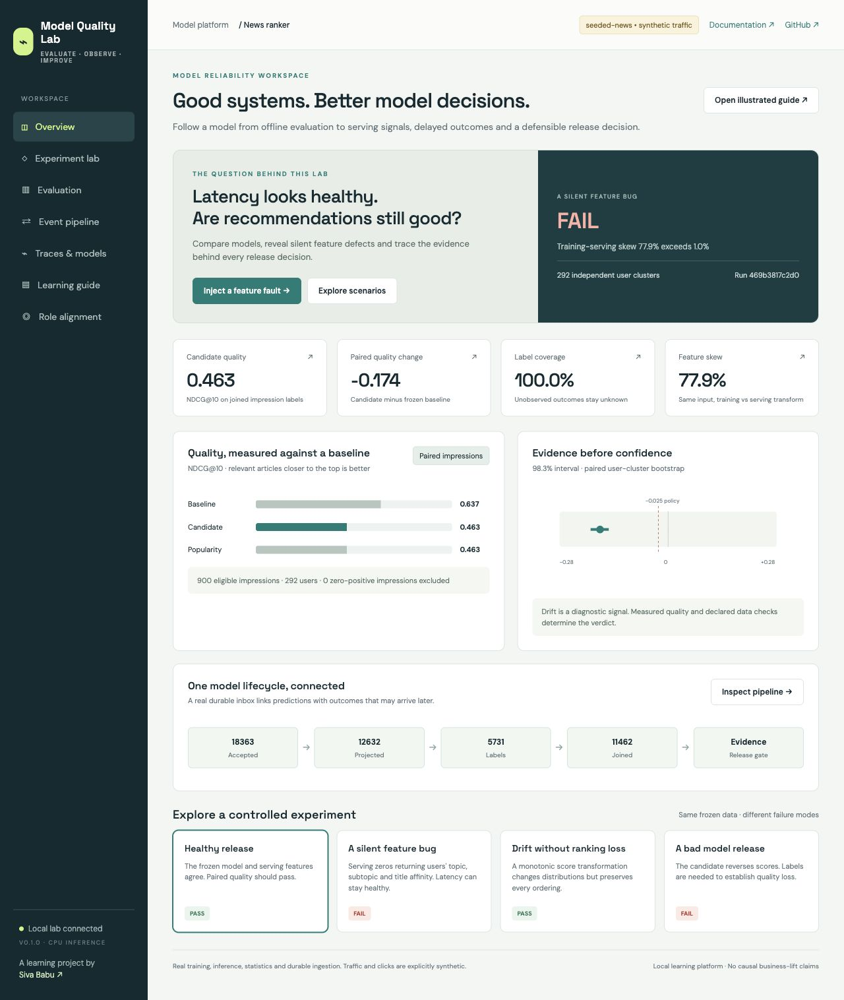

## Run the complete workflow

Python 3.12 or 3.13. No GPU or hosted API key is required for the default workflow.

```bash
git clone https://github.com/sivalinb/model-quality-lab.git
cd model-quality-lab
python3 -m venv .venv
source .venv/bin/activate
pip install -e '.[dev]'
mql suite
mql serve
```

Open **http://127.0.0.1:7856**. API documentation: `/docs`. Metrics: `/metrics`. The [operations guide](docs/OPERATIONS.md) covers native Grafana/Prometheus, public MIND data, actual local-model inference and the complete container stack.

1. Open **Experiment lab** and run a healthy release.
2. Inject **A silent feature bug**: serving loses user-interest features while the frozen baseline stays correct.
3. Inspect quality, feature skew, confidence intervals and affected user cohorts in **Evaluation**.
4. Run **Drift without ranking loss** to see why score changes alone do not establish degraded relevance.
5. Run **Labels arrive late**, then deliver remaining outcomes and re-evaluate the same predictions.
6. Inspect durable acceptance, projection, traces, semantic-ID ranking and the real local-language-model results.
7. Work through the exercises and design-review questions in the illustrated guide.

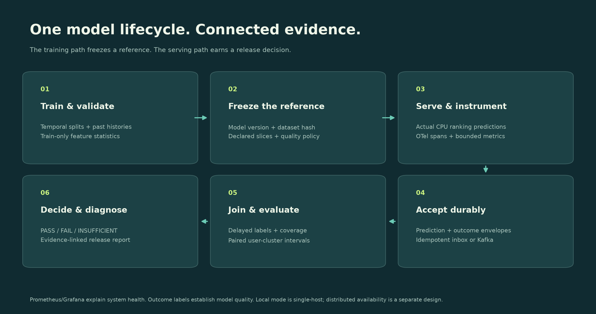

## What executes, and what it establishes

| Component | Execution and scope |
|---|---|
| Default news workload | Explicitly synthetic preference traffic and click labels, with frozen temporal splits |
| Learned ranker | Actual scikit-learn fitting and CPU inference; train-only feature statistics |
| Evaluation | Actual NDCG@10, MRR, recall, user-cluster bootstrap and declared cohort gates |
| Monitoring | Feature/score distributions, missingness and paired training-serving differences |
| Durable pipeline | Real WAL persistence, immutable event identities, worker fencing and atomic projections |
| Kafka / ClickHouse mode | Separate broker-acknowledged path, consumer projection, analytical sink and deduplicated queries |
| OTel / OpenInference | Real SDK spans; local JSONL and optional OTLP export; actual model-call token counts |
| Prometheus / Grafana | Live API measurements and a version-controlled eight-panel dashboard |
| Public recommendation data | Actual MIND-small training and held-out historical-impression replay; raw source data excluded |
| Generative ranking | Trained count-based autoregressive taxonomy-token model with constrained item decoding |
| Local SLM ranking | Actual Ollama calls; invalid outputs preserved and counted |
| Vision adapter | Actual digit-image classifier, holdout metrics and controlled pixel corruption |
| Public walkthrough | Interactive replay of saved measurements; no hosted model or writable backend |

## Measured examples

| Experiment | Baseline NDCG@10 | Candidate NDCG@10 | Result |
|---|---:|---:|---|
| Synthetic healthy release, 900 impressions | 0.6372 | 0.6372 | PASS |
| Synthetic serving feature fault | 0.6372 | 0.4633 | FAIL |
| Synthetic monotonic score change | 0.6372 | 0.6372 | PASS, despite score drift |
| Synthetic delayed outcomes | — | — | INSUFFICIENT at 35% coverage; re-evaluated after labels |
| Public MIND healthy replay, 1,800 impressions | 0.3954 | 0.3954 | PASS |
| Public MIND serving feature fault | 0.3954 | 0.3020 | FAIL; adjusted delta interval approximately [−0.108, −0.078] |

MIND training uses 8,000 complete impressions, plus 1,600 internal validation impressions. The evaluation uses 1,800 later official development impressions and 1,629 user clusters. This is a bounded learning baseline, not a MIND leaderboard entry or a causal CTR experiment. [Aggregate public-data evidence](docs/evidence/public-mind.json)

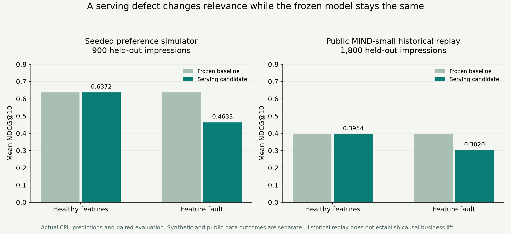

The actual six-case Qwen3 smoke run returned **4/6 valid permutations**. Two invalid outputs remain in the report. Quality on valid cases is paired with the comparator on those same cases; the small sample stays **insufficient evidence**. The digit-image classifier scored about **98.15%** clean accuracy and **50.74%** under controlled occlusion. [SLM evidence](docs/evidence/slm.json) · [Vision evidence](docs/evidence/vision.json)

## Illustrated functionality

The illustrations are editable SVG plus high-resolution PNG, generated by `scripts/build_illustrations.py`. Screenshots below are unmodified captures of the running interfaces.

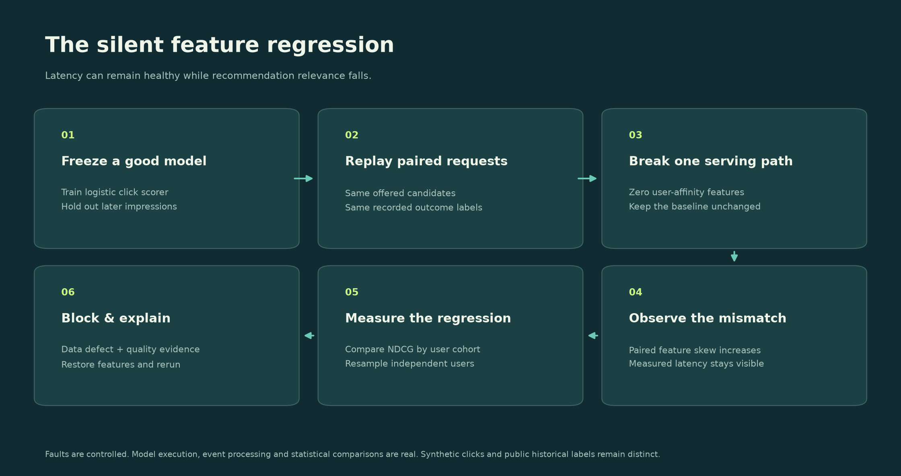

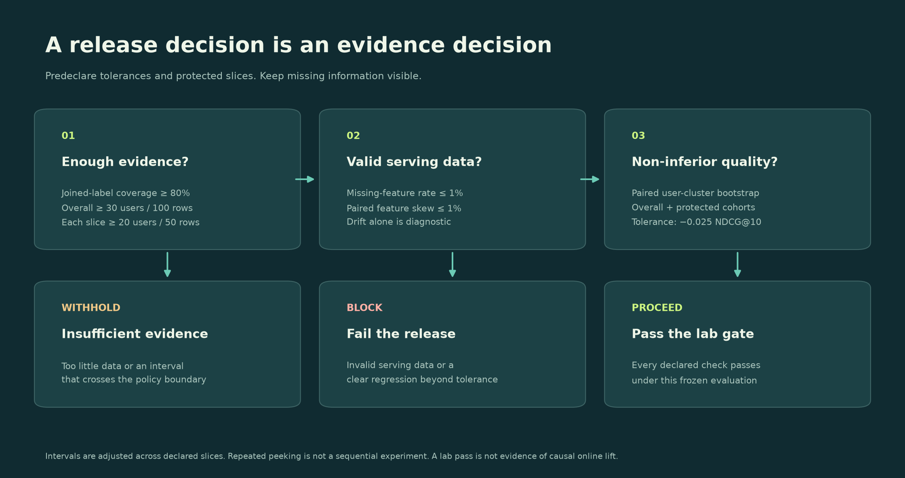

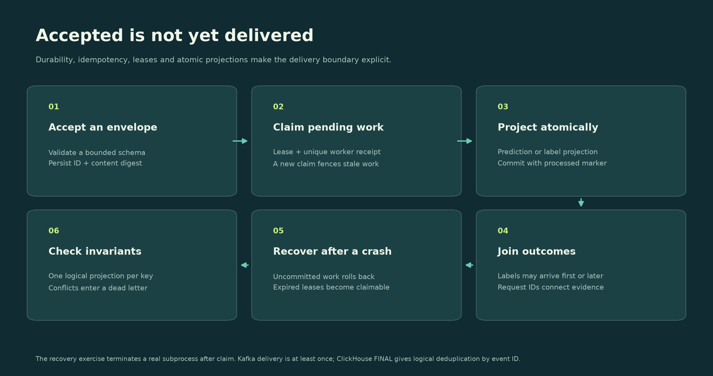

<details>
<summary><strong>Complete screenshot tour — every application page, public data, delayed labels, Grafana and responsive layout</strong></summary>

### Experiment catalog

Eight controlled scenarios use the same engine as the CLI, API and tests.

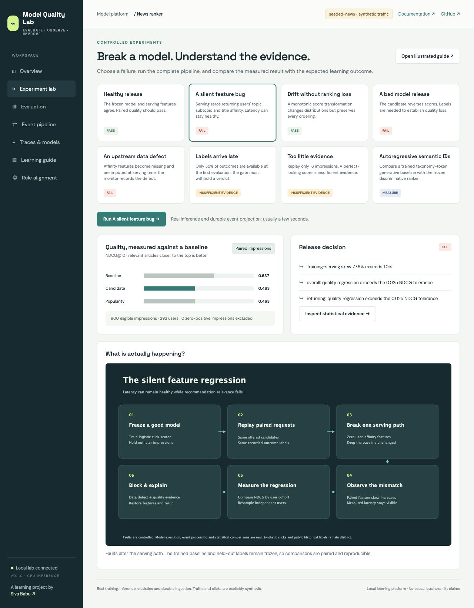

### Paired evaluation and root-cause evidence

Baseline/candidate quality, protected cohorts, confidence intervals, feature health and experiment history.

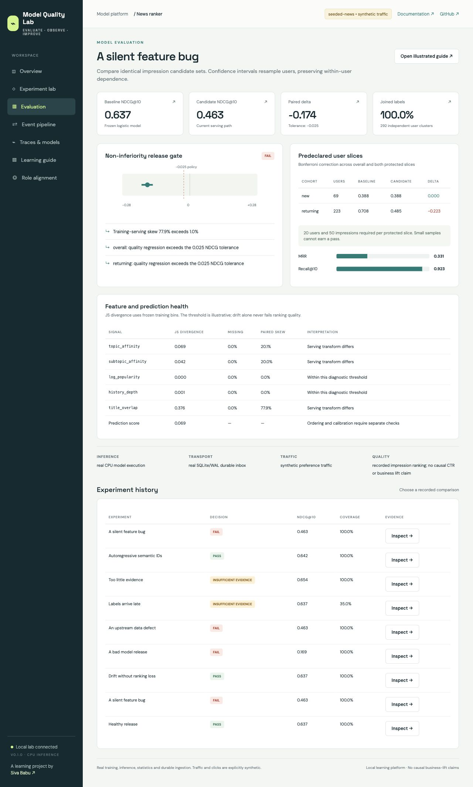

### Durable delivery and recovery

Acceptance is distinct from projection. The report includes a real consumer-process crash and restart.

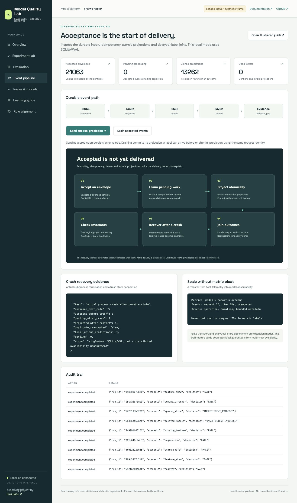

### Traces and multiple model families

Actual SDK spans, local-model validity and real image-classification measurements.

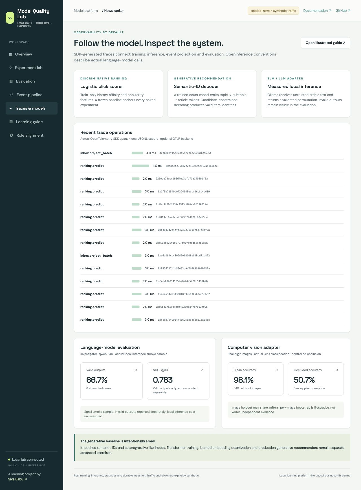

### Learning guide

Connect each experiment to code, statistical reasoning and architecture decisions.

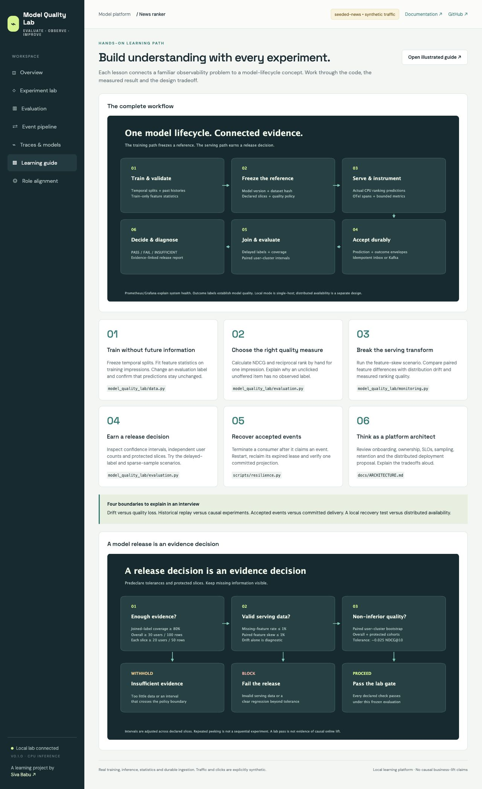

### Role alignment

An implementation map distinguishes demonstrated capabilities from advanced deployment and leadership exercises.

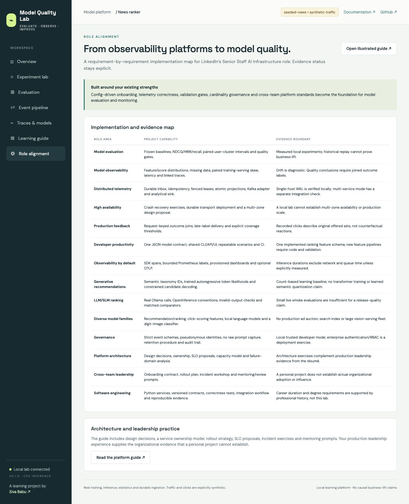

### Live Grafana

Actual Prometheus scrapes show outcome coverage, paired feature skew, queue state, evaluation decisions and API inference measurements.

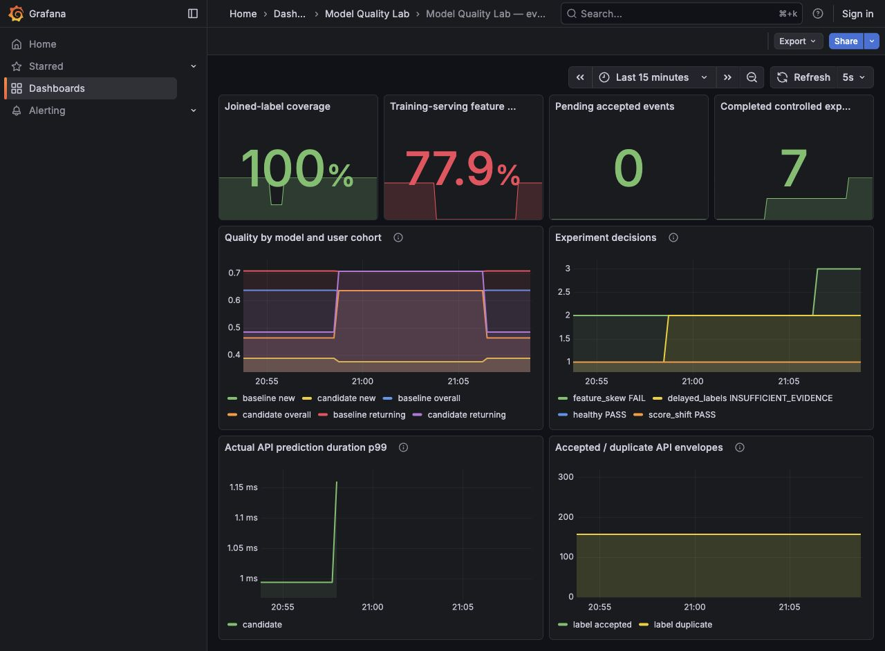

### Late-label decision

The gate withholds approval when most outcomes have not arrived.

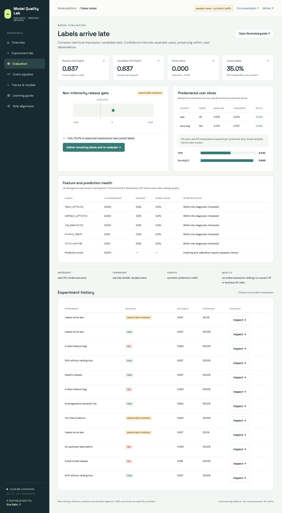

### Responsive application

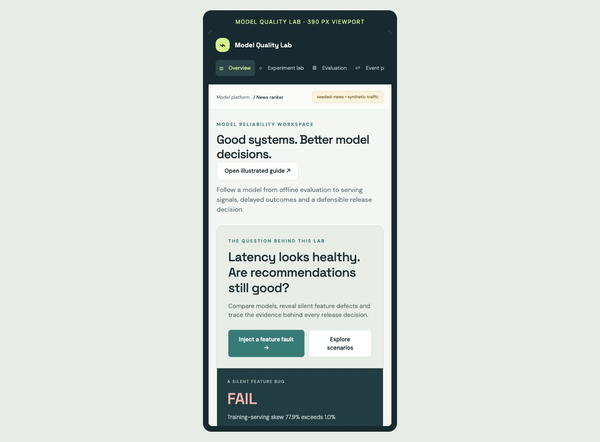

### Public recommendation data

The same application evaluates real historical MIND impressions, with a source fingerprint and recorded click outcomes.

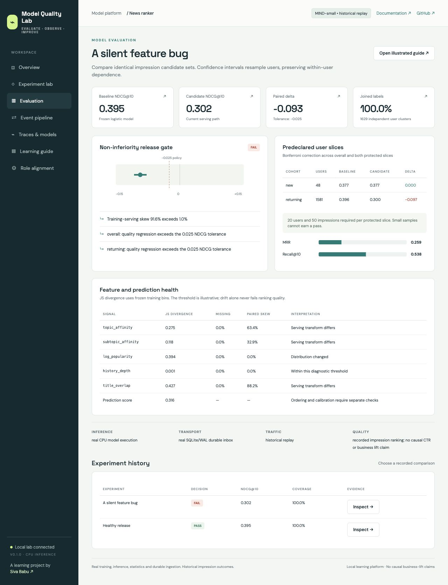

</details>

## Containers and telemetry

```bash
docker compose up --build -d
python scripts/integration_smoke.py --distributed
```

API 7856 · Grafana 3016 · Prometheus 9096 · Jaeger 16696 · ClickHouse HTTP 8127. Published ports bind to loopback. The stack's single broker and shared local projection volume teach integration; multi-zone availability remains a documented architecture proposal. The distributed smoke test verifies actual broker delivery, logical event deduplication, analytical visibility, scrapes, dashboard provisioning and exported traces.

## Learn from real failures

```bash
python -m pytest
python scripts/integration_smoke.py --in-process
python scripts/resilience.py
python scripts/benchmark.py --events 10000
mql vision
mql slm --model YOUR_INSTALLED_MODEL --limit 6
```

The initial local correctness suite passed **41 tests**. CI verifies Python 3.12/3.13 and the multi-service container path. [Current CI](https://github.com/sivalinb/model-quality-lab/actions) · [Recorded validation and limits](docs/VALIDATION.md)

## Project map

| Path | Responsibility |
|---|---|
| `model_quality_lab/data.py`, `models.py` | Temporal data contracts, features, training, semantic IDs, local SLM adapter |
| `evaluation.py`, `monitoring.py` | Task metrics, uncertainty, release decisions and distribution checks |
| `store.py`, `streaming.py` | Durable delivery, recovery, Kafka and ClickHouse |
| `api.py`, `cli.py`, `static/` | Shared execution engine, HTTP contracts and responsive UI |
| `configs/` | Model onboarding and job-requirement implementation map |
| `observability/` | Grafana dashboards, Prometheus scrape configuration and OTel Collector |
| `docs/` | Illustrated handbook, architecture, screenshots and aggregate evidence |
| `scripts/` | Real traffic, crash recovery, benchmark, integration and evidence export |
| `site/` | Credential-free recorded walkthrough for static hosting |

Built around observability platform experience, config-driven validation and telemetry governance, while adding direct model-quality learning. [Role coverage](docs/ROLE_COVERAGE.md) connects the work to the target AI infrastructure position.

Automatic retention, enterprise authentication, label correction, learned semantic quantization, transformer training and production availability are explicit follow-on work. Source datasets and third-party models keep their own licenses; this project's code is MIT licensed.
