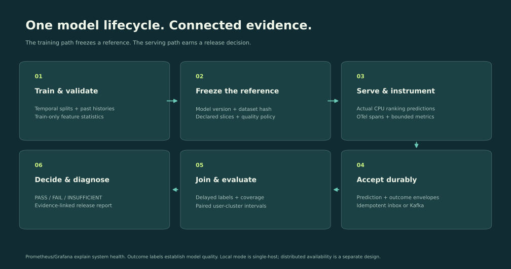

# Architecture and technical strategy

## Decision 1: Make the lifecycle observable by default

`data.py` defines the impression contract; `models.py` owns training and prediction. `engine.py` runs controlled experiments through `Store`, joins outcomes and invokes task-aware evaluation. The CLI, API and browser share that engine. OpenTelemetry SDK spans measure actual operations and write JSONL locally; an optional OTLP exporter connects the same instrumentation to a Collector and Jaeger. Ollama model calls use OpenInference conventions.

Prometheus labels are finite model aliases, declared cohorts, known scenarios and outcomes. Request IDs and user pseudonyms belong in event storage, not metric dimensions. Sampling a trace is independent of counting operational metrics. Production-quality statistics should use a defined event sample with inclusion probabilities, not whatever traces happen to be retained.

## Decision 2: Start with a durable single-host implementation

SQLite/WAL with `synchronous=FULL` supports an auditable local acceptance boundary. Envelopes have immutable IDs and content digests. Replays deduplicate identical envelopes; conflicts fail. Projection keys prevent multiple logical predictions per request/model. Labels can arrive in either order. Worker receipts fence reclaimed leases. Batch projection and processed markers commit in one transaction. Poison events enter a dead letter rather than preventing later work.

This is not a shared multi-zone database. API and workers in Compose share a volume on one host; it remains one failure domain. The actual crash exercise validates a process restart and durable local recovery. It does not validate disk loss, quorum failover or regional availability.

## Decision 3: Add a separate distributed transport exercise

Compose runs API → Kafka → consumer → local projection plus ClickHouse. API events in this mode acknowledge the broker before returning 202. The consumer validates schema, persists/projects locally, writes the analytical envelope, then commits the Kafka offset. A crash between sinks and offset commit causes replay. ClickHouse uses ReplacingMergeTree; queries requiring logical deduplication use `FINAL`. Physical duplicate rows can temporarily remain. There is no cross-system transaction or blanket exactly-once claim.

The experiment runner uses the local inbox for repeatable fault experiments. The separate distributed smoke test sends real HTTP envelopes through Kafka and verifies the analytical sink, Prometheus scraping, Grafana provisioning and OTLP traces. Keep these two evidence paths distinct.

## Decision 4: Keep model onboarding explicit

`configs/news.json` declares owner, task, feature order, protected cohorts, tolerance, coverage and retention policy. Feature order is validated. The gate consumes the declared quality parameters. This initial version supports one ranking feature pipeline; onboarding another feature schema requires an adapter and tests, rather than pretending any JSON can introduce a new model family. Classification and language-model examples use task-specific evaluators.

## Multi-zone design proposal

For a production deployment, split stateless ingress, stream processing, analytical queries, evaluation workers and control-plane metadata. Use a replicated Kafka cluster with three availability zones and appropriate ISR/ack settings, partition prediction and label streams by a stable request key, and use a durable replicated database for idempotency and state. Separate high-volume event retention from aggregate histories. Store versioned model/dataset/policy artifacts in object storage. Make schemas backward-compatible and migrate consumers before producers.

A request-keyed join needs event-time watermarks, late/out-of-order policies, bounded state TTL, label corrections and model-version lineage. Backpressure should produce explicit retryable responses before exhausting buffers. Poison records need accountable reprocessing. End-to-end delivery dashboards should distinguish accepted, broker-acknowledged, projected, analytically visible and outcome-joined counts.

**Proposed SLOs for review, not measured promises:** durable ingress availability 99.9%; p99 projection age below 30 seconds under a specified load; loss accounted for by event identity; daily quality-label coverage tracked per cohort; minimum mature-label windows before release decisions. Capacity and error budgets depend on event sizes, retention and failure-domain choices.

At an illustrative 10,000 predictions/s and 1 KB/event, uncompressed ingress is about 864 GB/day before replication, labels and indexes. Calculate actual encoded payload sizes, peak/steady ratios and replay recovery headroom. Publish hardware, batch sizes and inclusion of network/disk/inference costs with every benchmark. The local benchmark intentionally measures only its disclosed WAL path.

## Ownership and cross-team execution

The platform team owns transport, schema compatibility, SDKs and reliability. Model owners declare relevant slices, mature-label definitions and quality tolerance. Data producers own feature and label correctness; security partners own retention and access policy. An on-call playbook routes transport lag separately from serving skew and label-confirmed quality regressions.

Roll out in observation mode, compare against team-maintained evaluations, tune false-positive budgets using held-out incidents, then enable gates with documented rollback and exceptions. Run design reviews with recommendation, search and generative-model teams before making a shared abstraction mandatory.

The mentoring workshop asks engineers to diagnose the same fault from metrics, events and traces, then critique one platform decision. Record real feedback and adoption separately from the personal project's implementation.
